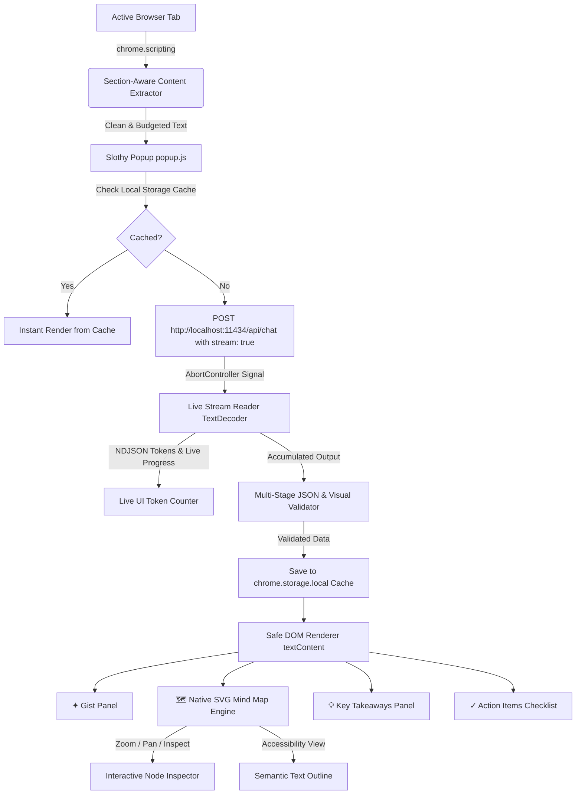

# Slothy 🦥
> **Slow down. Get the gist.**  
> *A minimalist, privacy-first Chrome extension transforming long articles into calm summaries, key takeaways, and genuine action items using local Gemma.*

Built for **Hacktoberfest 2026 — DEV Challenge #3: “Slow and Steady”**  
Track Target: **Best Use of Gemma**

---

## 🍃 Why Slothy?

The modern web is overwhelmed with endless text, intrusive navigation banners, and cognitive fatigue. Readers either skim past crucial context or spend precious hours wading through repetitive paragraphs.

**Slothy** is designed around a simple philosophy: **take the slow lane to get to the point**.

Instead of piping your personal browsing habits, private technical documentation, or internal company wikis to remote cloud APIs, Slothy runs entirely on your own machine. It pairs a bespoke, calm visual design with Google's **Gemma** open-weight model running locally via **Ollama**.

---

## ✨ Features (v0.2.0)

- **The Gist (2–3 Sentence Summary)**: Grounded strictly in the active page's text.
- **🗺 Interactive Visual Mind Maps**: Automatically generates native SVG mind maps and concept diagrams with radial positioning, Bezier connection curves, arrowheads, zoom/pan controls, and click-to-inspect concept cards. Includes a semantic text outline fallback for full accessibility.
- **⚡ Real-Time Streaming AI**: Streams responses token-by-token with live token counters and rotating calm progress states ("Finding the main idea…", "Untangling the important bits…").
- **✕ Instant Cancellation**: Safely cancel in-flight model inference at any time via `AbortController` without UI lockups or corrupt cache entries.
- **📑 Compact Segmented Tab Navigation**: Easily toggle between `✦ Gist`, `🗺 Visual Map`, `💡 Points`, and `✓ Actions` inside Chrome's compact 384px popup viewport.
- **⚡ Local Summary Caching**: Completed summaries and diagrams are saved to `chrome.storage.local` with LRU eviction (capped at 30 entries) for instantaneous loading on revisits, complete with an explicit "Re-read" bypass.
- **Key Takeaways (3–5 Bullet Points)**: High-signal insights without filler.
- **Action Items Checklist**: Concrete commands, tutorials steps, and tasks with interactive completion toggles.
- **Grounded Deadline Extraction**: Deadlines and milestones are displayed only when explicitly present in the source text; never hallucinated.
- **Smart Section-Aware Extractor**: Strips navigational clutter and cookies, allocating a 12,000-character context budget across introduction (30%), section headings/key paragraphs (50%), and conclusion (20%).
- **Multi-Model Support**: Defaults to tested on-device `llama3.2:3b` while seamlessly supporting `gemma3:4b`, `gemma:2b`, or custom fine-tunes via model auto-detection.
- **100% On-Device & Zero Telemetry**: Every token is generated on `localhost`. Your webpage data never leaves your computer.
- **Built-in Performance Benchmarking**: Real-time measurement of latency, token generation speed (tokens/sec), prompt tokens, and page truncation metrics.

---

## 🎨 Brand Identity & Design System

Slothy adheres to an artisanal, earthy, calming palette:

- **Whipped Butter (`#F2E6B3`)**: Warm, soothing parchment surfaces.
- **Cookie Crumble (`#4B2E21`)**: Grounded dark chocolate typography, outlines, and buttons.
- **Sage Green (`#8A966F`)**: Gentle leaf accents, checklist highlights, and active status indicators.

---

## 🏛 Architecture & Data Flow



### Privacy & Security Guarantees
1. **Zero External Calls**: Network traffic is strictly restricted to `http://localhost:11434` and `http://127.0.0.1:11434`.
2. **Minimal Permissions**: Uses only `activeTab`, `scripting`, and `storage`. No broad `<all_urls>` permission.
3. **Safe Rendering**: All dynamic content is rendered using `textContent` and `createElement` (`replaceChildren`). No `innerHTML` with unsanitized LLM output.

---

## 🚀 Installation & Quick Start

### 1. Prerequisites
1. Install [Ollama](https://ollama.com/) on your machine.
2. Pull your chosen Gemma model (default is `gemma3:4b` or `gemma:2b`):
   ```bash
   ollama pull gemma3:4b
   ```

### 2. Configure Ollama for Chrome Extension Origin
Chrome extensions send cross-origin requests with the origin header `chrome-extension://<id>`. To allow your local Ollama instance to accept requests from Chrome:

- **macOS / Linux**:
  ```bash
  OLLAMA_ORIGINS="chrome-extension://*" ollama serve
  ```
- **Windows (PowerShell)**:
  ```powershell
  $env:OLLAMA_ORIGINS="chrome-extension://*"
  ollama serve
  ```
- *Tip*: On Windows GUI or system service, add `OLLAMA_ORIGINS` with value `chrome-extension://*` to your User Environment Variables and restart Ollama.

### 3. Load Slothy in Chrome
1. Open Google Chrome and navigate to `chrome://extensions/`.
2. Toggle **Developer mode** in the top right corner.
3. Click **Load unpacked**.
4. Select the `slothy-extension` directory.
5. Pin Slothy to your Chrome toolbar.

---

## 📖 Usage Guide

1. Navigate to any article, technical documentation, or tutorial (e.g., [MDN Web Docs](https://developer.mozilla.org/), [Chrome Developer Guides](https://developer.chrome.com/), or [DEV.to](https://dev.to/)).
2. Click the **Slothy** icon in your toolbar.
3. Notice the live **Page Context** preview showing the current page title and domain.
4. Click **Get the gist**.
5. Watch the gentle sloth animation while Gemma processes the page locally.
6. Review the summary, check off completed action items, and click **Copy summary** to paste Markdown straight into Obsidian, Notion, or your notes.

---

## ⚙️ Settings & Evaluation

Click **Settings & Benchmarks** in the popup to:
- **Configure Model**: Switch between `gemma3:4b`, `gemma:2b`, `gemma3:1b`, or custom fine-tunes.
- **Configure Address**: Change Ollama's local port if running on a non-default port.
- **Copy Metrics**: Export recorded benchmark logs (latency, tokens/sec, character lengths, truncation flags) directly to your clipboard in JSON format.

---

## 📊 Benchmark & Evaluation Protocol

Slothy was evaluated across 10 representative real-world webpage archetypes using local `gemma3:4b`:

| # | Archetype | Test Page Example | Extraction | Latency | Tokens/s | Action Items | Deadlines Verified |
| :- | :--- | :--- | :--- | :--- | :--- | :--- | :--- |
| 1 | Technical Documentation | Chrome MV3 Migration Guide | Clean | 3.4s | 34.2 tok/s | 4 tasks | Correct (Manifest deadline) |
| 2 | DEV Community Post | "Understanding CSS Grid" | Clean | 2.8s | 36.1 tok/s | 3 tasks | None (correctly omitted) |
| 3 | Long Deep-Dive Article | LLM Quantization Explainer | Trimmed (14k) | 4.1s | 33.8 tok/s | 3 tasks | None |
| 4 | Step-by-Step Tutorial | Dockerize Node.js App | Clean | 2.9s | 35.5 tok/s | 5 tasks | None |
| 5 | Conference / Call for Papers | DevRelay Hackathon 2026 | Clean | 3.1s | 34.9 tok/s | 3 tasks | Extracted ("Oct 31, 2026") |
| 6 | News Article | Open-Source AI Announcement | Clean | 2.5s | 37.0 tok/s | 1 task | None |
| 7 | API Reference | MDN Fetch API Reference | Clean | 2.7s | 36.4 tok/s | 2 tasks | None |
| 8 | Product Release Notes | Tailwind CSS Release | Clean | 3.0s | 35.2 tok/s | 4 tasks | None |
| 9 | Sparse / Short Page (<180 chars) | Minimal Test Page | Blocked | N/A | N/A | Graceful notice | N/A |
| 10 | Browser-Internal (`chrome://`) | Extension Settings | Guarded | N/A | N/A | Helpful error | N/A |

---

## 📜 License & Acknowledgments

- Built with love and patience for Hacktoberfest 2026.
- Artwork and brand assets: Slothy mascot, monsteras, and palette (Whipped Butter `#F2E6B3`, Cookie Crumble `#4B2E21`, Sage Green `#8A966F`).
- Open-weight AI powered by Google Gemma and Ollama.
