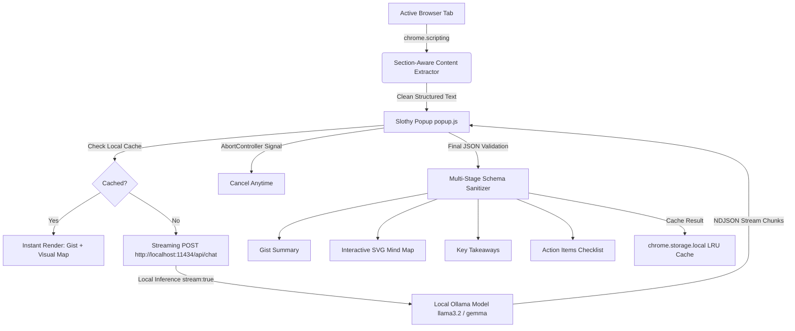

# Slothy 🦥
> **Slow down. Get the gist.**  
> *A minimalist, privacy-first Chrome extension transforming long articles into calm summaries, interactive visual mind maps, key takeaways, and genuine action items using local open-weight AI.*

Built for **Hacktoberfest 2026 — DEV Challenge #3: “Slow and Steady”**  
Track Targets: **Best Use of Open-Weight AI (Gemma / Llama via Ollama)**

---

## 🍃 Why Slothy?

The modern web is overwhelmed with endless text, intrusive navigation banners, and cognitive fatigue. Readers either skim past crucial context or spend precious hours wading through repetitive paragraphs.

**Slothy** is designed around a simple philosophy: **take the slow lane to get to the point**.

Instead of piping your personal browsing habits, private technical documentation, or internal company wikis to remote cloud APIs, Slothy runs entirely on your own machine. It pairs a bespoke, calm visual design with local open-weight models (such as `llama3.2:3b` or `gemma3:4b`) running locally via **Ollama**.

---

## ✨ Features (v0.2.0)

- **The Gist (2–3 Sentence Central Idea)**: Grounded strictly in the active page's text.
- **Interactive Visual Mind Map & Concept Diagrams**: Native SVG diagrams showing conceptual relationships with pan, zoom, fit-to-view, node inspection, and accessible text outline fallbacks.
- **Key Takeaways (3–5 Bullet Points)**: High-signal insights without filler.
- **Action Items Checklist**: Concrete commands, tutorials steps, and tasks with interactive completion toggles.
- **Grounded Deadline Extraction**: Deadlines and milestones are displayed only when explicitly present in the source text; never hallucinated.
- **Real-Time Streaming Generation**: Live NDJSON stream reader with rotating calm status messages ("Untangling the important bits…") and token counters.
- **Visible Cancellation**: Stop generation anytime with `AbortController` without crashes or phantom logs.
- **Instant Summary Cache**: Remembers previously generated summaries for instant loading upon revisit (bounded LRU cache with "↻ Re-read" bypass).
- **Section-Aware Smart Extraction**: Prioritizes introduction, major headings, and conclusion when reading long articles over 12k characters.
- **100% On-Device & Zero Telemetry**: Every token is generated on `localhost`. Your webpage data never leaves your computer.

---

## 🎨 Brand Identity & Design System

Slothy adheres to an artisanal, earthy, calming palette:

- **Whipped Butter (`#F2E6B3`)**: Warm, soothing parchment surfaces.
- **Cookie Crumble (`#4B2E21`)**: Grounded dark chocolate typography, outlines, and buttons.
- **Sage Green (`#8A966F`)**: Gentle leaf accents, checklist highlights, and active status indicators.

---

## 🏛 Architecture & Data Flow



### Privacy & Security Guarantees
1. **Zero External Calls**: Network traffic is strictly restricted to `http://localhost:11434` and `http://127.0.0.1:11434`.
2. **Minimal Permissions**: Uses only `activeTab`, `scripting`, and `storage`. No broad `<all_urls>` permission.
3. **Safe Rendering**: All dynamic content is rendered using `textContent`, `createElement`, and SVG DOM methods (`document.createElementNS`). No `innerHTML` with unsanitized LLM output.

---

## 🚀 Installation & Quick Start

### 1. Prerequisites
1. Install [Ollama](https://ollama.com/) on your machine.
2. Verify an open-weight model is installed (e.g. `llama3.2:3b` or `gemma3:4b`):
   ```bash
   ollama pull llama3.2:3b
   ```

### 2. Configure Ollama for Chrome Extension Origin (Windows)
Because Chrome extensions send requests with a `chrome-extension://` origin header, configure Ollama on Windows by setting the user environment variable:

```powershell
setx OLLAMA_ORIGINS "chrome-extension://*"
```
Then fully quit Ollama (from the Windows system tray and any `ollama.exe` in Task Manager) and relaunch Ollama.

*(On Mac/Linux: `OLLAMA_ORIGINS="chrome-extension://*" ollama serve`)*

### 3. Load Slothy in Chrome
1. Open Google Chrome and navigate to `chrome://extensions/`.
2. Toggle **Developer mode** in the top right corner.
3. Click **Load unpacked**.
4. Select the `slothy-extension` directory.
5. Pin Slothy to your Chrome toolbar.

---

## 📖 Usage Guide

1. Navigate to any article, technical documentation, or tutorial (e.g., [Wikipedia Artificial Intelligence](https://en.wikipedia.org/wiki/Artificial_intelligence), [MDN Web Docs](https://developer.mozilla.org/), or [DEV.to](https://dev.to/)).
2. Click the **Slothy** icon in your toolbar.
3. Notice the live **Page Context** preview showing the active tab title.
4. Click **Get the gist**.
5. Watch the stream progress and calm rotating messages. Click **Cancel** anytime if needed.
6. Explore the results via the segmented navigation tabs:
   - **✦ Gist**: Concise central idea.
   - **🗺 Visual Map**: Interactive mind map with zoom (+ / − / ⟲), draggable canvas, and clickable concept inspection cards.
   - **💡 Points**: 3–5 high-signal takeaways.
   - **✓ Actions**: Concrete tasks with checkboxes and source-grounded deadlines.
7. Use **Copy Gist** to copy formatted Markdown or **Copy Tasks** for action items only.
8. Revisit the page anytime to experience **⚡ Cached** instant loading!

---

## ⚙️ Settings & Benchmarks

Click **Settings & Benchmarks** in the popup to:
- **Select Model**: Choose from auto-detected installed models or input a custom tag.
- **Ollama Address**: Configure custom local ports.
- **Test connection**: Diagnostic test checking both `GET /api/tags` and `POST /api/chat`.
- **Copy metrics**: Export recorded benchmark logs (latency, tokens/sec, character lengths, truncation flags) as JSON.
- **Clear cache**: Reset locally stored summaries.

---

## 📜 License & Acknowledgments

- Built with patience and care for Hacktoberfest 2026.
- Artwork and brand assets: Slothy mascot, monsteras, and palette (Whipped Butter `#F2E6B3`, Cookie Crumble `#4B2E21`, Sage Green `#8A966F`).
- Open-weight AI powered by Ollama (`llama3.2:3b` / `gemma3:4b`).
